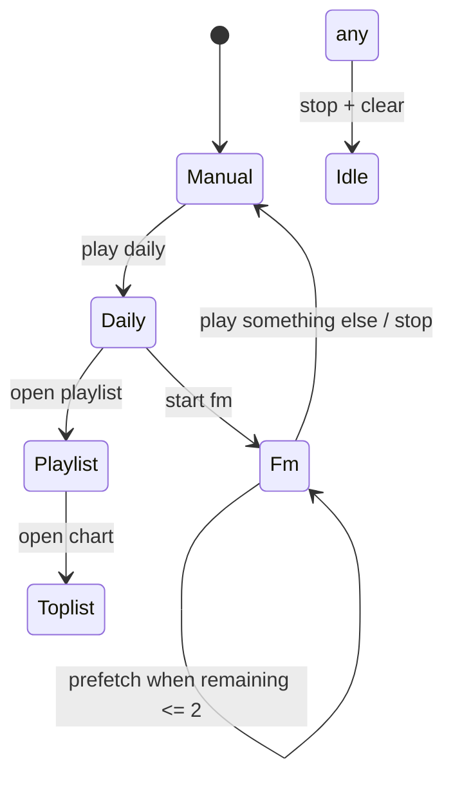
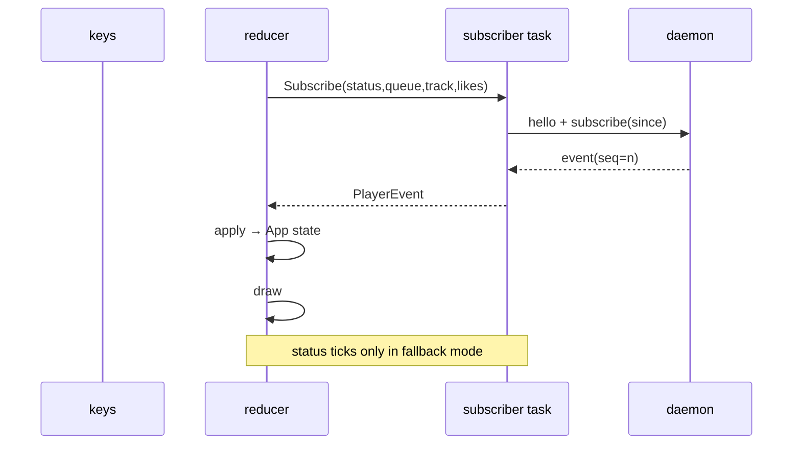

# Sprint 2 — System Design

> Companion to [`product-design.md`](./product-design.md).
> Scope: daily recommendations, Personal FM, like/unlike, toplists, lyrics pane,
> push events, MCP server, polish.

Status: **Proposed** · Builds on sprint 1 ([`../system-design.md`](../system-design.md))

---

## 1. Constraints and quality attributes

| Constraint | Consequence |
| --- | --- |
| Only the daemon mutates playback/queue | Every new action is a protocol command; UIs never write state |
| Existing v1 clients must keep working | Protocol v2 is negotiated; old framing stays valid |
| Agents need low-latency reactions | Push events with bounded, coalesced delivery |
| Provider surface is fragile | New routes confined to `ncmapi` 1.2 with contract tests |
| TUI must stay at 60 fps | No I/O in the render loop; events mutate a view model |
| No secrets off-device | Likes/FM only on explicit user action; no telemetry |

Performance budgets: event latency p99 < 50 ms, lyrics parse < 5 ms for a
10-minute track, FM prefetch when ≤ 2 tracks remain, cache memory < 8 MB.

## 2. Changes at a glance

```mermaid
flowchart LR
  subgraph ncmapi 1.2
    D[discovery: daily, toplists]
    R[radio: fm, trash, like, likelist]
  end
  subgraph lekima-domain
    DM[models: Lyrics, LyricLine, QueueKind, LikeState]
    EV[event: PlayerEvent, Seq]
    PT[ports: DiscoveryService extensions]
  end
  subgraph lekima-core
    P[Player: FM mode, like cache]
    B[EventBus: broadcast]
  end
  subgraph lekima-ipc
    V2[protocol v2: hello/subscribe/event]
  end
  subgraph frontends
    TUI[TUI: Home panes, lyrics pane, event subscriber]
    CLI[CLI: daily/fm/like/toplist/watch/mcp]
    MCP[MCP stdio server]
  end
  ncmapi 1.2 --> lekima-ncm
  lekima-ncm --> PT
  PT --> P
  P --> B --> V2 --> TUI
  V2 --> CLI
  CLI --> MCP
  DM --> P
  EV --> B
```

### 2.1 New/changed crates

| Crate | Change |
| --- | --- |
| `lekima-domain` | `Lyrics`/`LyricLine`, `QueueKind`, `LikeState`, `PlayerEvent`, `seq`; new port methods for daily/FM/toplists/like |
| `lekima-core` | FM queue mode + prefetch, like cache + optimistic rollback, `EventBus`, event emission on every transition |
| `lekima-ncm` | Map daily/FM/toplist/like payloads; typed lyrics with timings |
| `lekima-ipc` | Protocol v2: `Hello`, `Subscribe`, `Unsubscribe`, `Event` frames, `seq`, ring buffer |
| `lekima-tui` | Home view, section router, lyrics pane + LRC parser use, subscriber loop, counts, yank |
| `lekima` | New subcommands, `watch`, `mcp` server, event rendering |
| `ncmapi` (1.2) | Routes + models + services for the four new areas |

## 3. Provider layer (`ncmapi` 1.2)

### 3.1 Routes and signatures

| Area | Route | Signature | Notes |
| --- | --- | --- | --- |
| Daily | `POST /api/v3/discover/recommend` | `discovery().daily() -> ApiResponse<DailyBody>` | Requires session; `dailySongs`, `recommendReasons` |
| FM | `POST /api/v1/radio/get` | `radio().fm_batch() -> ApiResponse<FmBody>` | Returns 3–5 tracks |
| FM trash | `POST /api/radio/trash` | `radio().trash(id)` | Session-scoped removal |
| Like | `POST /api/radio/like` | `radio().set_like(id, bool)` | `alg=itembased`, `time=3` |
| Liked ids | `POST /api/likelist` | `radio().liked_ids(user)` | Used to seed the cache |
| Toplists | `POST /api/toplist` | `discovery().toplists()` | No session needed |

Models keep provider names (`dailySongs`, `recommendReasons`, `data`) in
`ncmapi`; the adapter maps them to domain names, so provider renames never leak
into lekima.

### 3.2 Error and edge behaviour

- `code == 301` ⇒ `AuthenticationRequired` for daily/FM/like; toplists stay
  public.
- Empty FM batch with `code == 200` ⇒ `NotFound("fm exhausted")`; the core treats
  it as “station empty for now” and retries once after 2 s.
- Like endpoint returns `{code: 200, data: ...}`; a non-200 body code maps to
  `Unavailable` and triggers optimistic rollback.
- Rate limits: no automatic retries for likes/trash (user intent must not be
  duplicated); read endpoints may retry once with jitter.

### 3.3 Versioning

`ncmapi 1.1` is published (tag `v1.1.0`). Sprint 2 adds `1.2.0`: purely
additive services/models. Steps: contract tests (wiremock fixtures + stub
transport), `cargo publish --dry-run`, tag, publish, then bump lekima’s pin and
remove any patch. MSRV unchanged.

## 4. Domain model additions

```rust
pub struct LyricLine {
    pub at: Duration,
    pub text: String,
    pub translation: Option<String>,
}

pub struct Lyrics {
    pub lines: Vec<LyricLine>,      // sorted by `at`
    pub offset: Duration,           // user adjustment, applied at render
    pub raw: String,                // original LRC for agents
}

pub enum QueueKind { Manual, Daily, Fm, Toplist, Playlist(PlaylistId), Liked }

pub struct LikeState {
    pub track: TrackId,
    pub liked: bool,
    pub pending: bool,              // optimistic write in flight
}

pub enum PlayerEvent {
    TrackChanged { track: Option<Track>, queue: QueueKind },
    StatusChanged { state: PlaybackState },
    QueueChanged { tracks: Vec<Track>, index: Option<usize>, kind: QueueKind },
    LikeChanged { track: TrackId, liked: bool },
    FmBatchLoaded { count: usize },
    Error { code: ErrorCode, message: String },
}
```

Invariants:

- `Lyrics.lines` is sorted and deduplicated by timestamp; `offset` never moves
  a line before zero when applied.
- `QueueKind::Fm` is the only kind that may grow without bound; it is capped at
  200 queued tracks (oldest played tracks are dropped).
- `LikeState.pending` is never persisted; it exists only in the daemon.

The LRC parser is pure and lives in `lekima-domain::lyrics`:

```rust
pub fn parse_lrc(raw: &str, translation: Option<&str>) -> Lyrics
```

Rules: tag lines (`[ar:]`, `[ti:]`, `[by:]`, `[offset:]`) are metadata; multiple
timestamps per line duplicate the text; `[mm:ss.xx]` and `[mm:ss.xxx]` supported;
`[offset:+ms]` is applied at parse time; empty text lines are skipped; unparsable
lines are preserved as untimed text at the end (never dropped).

## 5. Core changes

### 5.1 Queue modes



`Player` gains:

```rust
pub async fn play_daily(&self) -> Result<PlaybackState>;
pub async fn fm_start(&self) -> Result<PlaybackState>;
pub async fn fm_next(&self, trash: bool) -> Result<Option<Track>>;
pub async fn fm_stop(&self) -> Result<()>;
pub async fn set_like(&self, id: TrackId, liked: bool) -> Result<bool>;
```

FM prefetch runs as a daemon task holding a weak reference to the player:

- Trigger: after any advance, `remaining <= 2` and kind is FM.
- Guard: one in-flight prefetch (`AtomicBool`), dedupe ids against the live
  batch and a `HashSet<TrackId>` of trashed tracks.
- Failure: emit `PlayerEvent::Error`, retry with exponential backoff (2 s, 4 s,
  8 s, cap 30 s), never block playback.

Like cache:

- `HashMap<TrackId, bool>` seeded from `liked_ids` on login/first use.
- `set_like`: optimistic insert with `pending=true` → provider call → confirm or
  rollback + event.
- Serialised per track with a small mutex map so double-presses cannot race.

### 5.2 Event bus

```rust
pub struct EventBus {
    sender: broadcast::Sender<SequencedEvent>,
    ring: Mutex<VecDeque<SequencedEvent>>, // last 256
    seq: AtomicU64,
}
```

- Every mutation calls `bus.publish(event)` **after** state is committed.
- `publish` assigns `seq`, appends to the ring, then broadcasts (lagging
  receivers drop status events; state events are reconstructed from the ring on
  resubscribe).
- Ordering guarantee: per-process total order by `seq`. Clients may detect gaps
  and resync with `Status`/`Queue`.

## 6. IPC protocol v2

### 6.1 Handshake

```jsonc
// client → daemon
{"id":1,"command":{"type":"hello","protocol":2}}
// daemon → client
{"id":1,"result":{"type":"welcome","protocol":2,"seq":128,"capabilities":["events","fm","daily","like","toplists"]}}
```

Rules:

- A v2 daemon accepts v1 commands unchanged (no `hello` required).
- A v2 client against a v1 daemon receives `bad_request` for `hello`; it must
  fall back to polling and disable event-only UX.
- `capabilities` is the source of truth for feature discovery; `capabilities`
  CLI command merges daemon capabilities with the static command catalogue.

### 6.2 Subscription and events

```jsonc
{"id":2,"command":{"type":"subscribe","events":["status","queue","track","likes"],"since":128}}
{"id":2,"result":{"type":"subscribed","since":128}}
{"event":{"seq":129,"type":"track_changed","track":{…},"queue":"fm"}}
{"event":{"seq":130,"type":"status_changed","state":{…}}}
```

Transport: the subscribing connection switches from request/reply to
bidirectional framing. Replies to new commands on the same connection carry
`id`; events carry `seq` and no `id`. A single writer per connection (daemon
task) guarantees no interleaving.

Backpressure policy:

| Event | Policy |
| --- | --- |
| `status_changed` | Coalesce to latest at 4 Hz; drop if the outgoing queue is full |
| `track_changed`, `queue_changed`, `like_changed` | Bounded queue (64); if full, drop the connection and mark it stale (client resubscribes with `since`) |
| `error` | Never dropped |

Ring buffer: 256 sequenced events. `subscribe {since}`:
- `since >= ring.first().seq` and `since <= last` ⇒ replay gap, then live.
- `since < ring.first().seq` ⇒ `subscribed` with `resync: true`; client must call
  `Status` and `Queue` before trusting the stream.

### 6.3 Watch client

```text
lekima watch --events status,queue --since 120 --json
```

- Connects, `hello`, `subscribe`, then copies event frames to stdout as NDJSON.
- Aggregates nothing; exit 0 on SIGINT/SIGTERM; exit 7 if the daemon is
  unreachable (no autostart for watch — an agent should know).
- Reconnects with exponential backoff (250 ms → 5 s) unless `--once` is given.

## 7. TUI architecture changes

### 7.1 View model

```rust
pub struct App {
    pub route: Route,             // Home, Tracks{source}, Queue, Help, Lyrics
    pub home: HomeSections,       // daily, toplists, liked, playlists
    pub lyrics: LyricsView,       // Option<Lyrics>, scroll, offset
    pub liked: HashSet<TrackId>,
    pub counts: CountPrefix,      // pending digits for vim counts
    pub subscription: SubscriptionState,
    ...
    pub events: EventStream,      // subscriber / poll fallback
}
```

Reducer stays pure: `KeyEvent × App → Action`; events are folded in `apply`.
Rendering reads only `App`.

### 7.2 Event-driven loop



- One long-lived connection, owned by a task; reconnect with resubscribe.
- Coalescing on the UI side: at most one redraw per event batch (drain the
  channel before drawing).
- Fallback (v1 daemon): the existing 250 ms status poll + on-demand queue
  refresh, flagged in the footer (“polling”).

### 7.3 Lyrics pane

- Parsing: `lekima-domain::lyrics::parse_lrc` in the IPC reply (the daemon
  returns parsed lines + raw text). The TUI never parses provider data.
- Highlight selection: `partition_point` over sorted timestamps, O(log n) per
  frame.
- Layout: `Layout` splits at ≥100 cols; otherwise overlay. The queue table gets
  `Constraint::Min(40)` so it never collapses below usability.
- Scroll: keep the active line at 40% height; manual scroll pauses auto-scroll
  until the next track (or `g`).

### 7.4 Home sections and caching

- Each section has `Idle | Loading | Ready(ts) | Failed`.
- TTLs: daily 30 min, toplists 15 min, liked 5 min (invalidated on like).
- `Ctrl-r` forces refresh of the focused section.
- Rendering a `Loading` section shows one skeleton row with the section title,
  never a blank pane.

## 8. MCP server

### 8.1 Process model

```
agent host ──stdio JSON-RPC──> lekima mcp ──UDS protocol v2──> daemon
```

- `lekima mcp` is a thin adapter: no playback, no cache, no session.
- On start: `initialize` → `tools/list`; it does not touch the daemon until the
  first tool call.
- On daemon loss: tool call returns an MCP error `isError: true` with
  `structuredContent.error.code = "daemon"`; next call retries the connection.
- Stdout is reserved for JSON-RPC; logs go to stderr; `RUST_LOG` honoured.
- Shutdown: SIGTERM/EOF on stdin ⇒ exit 0.

### 8.2 Tool mapping

| Tool | IPC command | Result data |
| --- | --- | --- |
| `player_status` | `Status` | `PlaybackState` |
| `search` | `Search` | `SearchResults` |
| `play` | `Play { Query/Tracks/Playlist }` | `PlaybackState` |
| `pause` / `resume` | `Pause`/`Resume` | `PlaybackState` |
| `next` / `previous` | `Next`/`Prev` | `PlaybackState` |
| `set_volume` | `SetVolume` | `PlaybackState` |
| `queue_add` | `Enqueue` | `Ack` + queue |
| `queue_list` | `Queue` | `Queue` |
| `lyrics` | `Lyrics` | `Lyrics` |
| `daily` | `Play { Daily }` | `PlaybackState` |
| `fm` | `FmStart`/`FmNext` | `PlaybackState` |

Tool schemas reuse the serde shapes; `content` is `"Playing Mota — Russian
Circles"` so chat UIs have something to say. Read-only tools are `player_status`,
`search`, `queue_list`, `lyrics`.

### 8.3 Safety

- No tool can read the session file; no tool takes a cookie/token argument.
- `play` with a free-form query performs its own search; it cannot execute shell
  commands.
- The server refuses to start a daemon when `daemon.autostart = false`.

## 9. Caching and storage

| Data | Store | TTL | Bound |
| --- | --- | --- | --- |
| Daily list | in-memory | 30 min / per user | 1 entry |
| Toplists | in-memory | 15 min | 1 entry |
| Liked ids | in-memory | session | 50k ids |
| FM batch | in-memory | session | 200 tracks |
| Lyrics | memory LRU + disk | 30 days | 64 entries / 20 MB disk |
| Event ring | in-memory | n/a | 256 events |

Disk layout: `cache/lyrics/<track-id>.json` (`0600`, plain text only). No
account identifiers in filenames or contents.

## 10. Failure modes

| Scenario | Behaviour |
| --- | --- |
| Daily/FM needs session | `unauthorized` + login hint; Home shows the hint inline |
| FM batch empty | retry once after 2 s; then “station empty”, playback stops cleanly |
| FM track fails to resolve | skip after one retry, emit `error` event, continue |
| Like call fails | optimistic marker rolls back, toast + event |
| Translation missing | original text only; `data.translation` omitted |
| Lyrics load fails | pane shows error with `r` retry; playback unaffected |
| Subscriber is slow | status events dropped, state events close the connection and force resync |
| v1 daemon | TUI falls back to polling; new commands return `bad_request` and the CLI explains |
| Daemon restarts while watching | client reconnects with `since=last_seq`; on `resync` it fetches status/queue |
| MCP host sends unknown tool | JSON-RPC error, server stays alive |

## 11. Testing strategy

| Area | Tests |
| --- | --- |
| ncmapi 1.2 | Stub-transport contract tests per route; wiremock for HTTP errors; fixtures for daily/FM/toplist/like |
| LRC parser | Table-driven: tags, multi-timestamp, offset, malformed, translation merge, ordering, fuzz for no panic |
| Core FM | Fake providers: prefetch threshold, dedupe, trash, retry/backoff, cap at 200 |
| Likes | Optimistic success/failure, concurrent double-press, cache seeding |
| Events | Sequence monotonicity, ring replay, gap resync, slow-subscriber policy |
| Protocol v2 | Golden frames, v1 compatibility matrix, subscribe/unsubscribe, `since` replay |
| TUI | Render snapshots for Home/lyrics (wide/narrow), reducer tests for counts/yank, no I/O in render |
| CLI | Contract tests for new commands, `watch` NDJSON stream, exit codes |
| MCP | stdio integration test with initialize/tools/list/call/error; inspector smoke |
| E2E | Fake provider + fake audio daemon; drive CLI and TUI reducer; assert events order |

## 12. Rollout plan

1. `ncmapi 1.2.0` branch → contract tests → dry-run → tag → publish → pin.
2. Domain/lyrics + events in `lekima-domain` (pure, tests first).
3. Core FM/likes/event bus; daemon wires the bus and v2 protocol.
4. TUI Home + subscriber + lyrics pane; fallback path tested against a v1 fake.
5. CLI commands + `watch` + `mcp`.
6. Polish (themes, counts, yank).
7. Release `lekima 0.2.0`; docs and README updated.

Each step is shippable behind a working v1 path; no flag day.

## 13. ADRs for this sprint

| ADR | Decision | Rationale |
| --- | --- | --- |
| 011 | Push events, coalesced, sequenced, ring-buffered | Removes polling without unbounded memory or lost state |
| 012 | Protocol v2 negotiated in-band | One socket, no duplicate server, v1 clients unaffected |
| 013 | FM is a queue mode with prefetch | Infinite station semantics without a second player |
| 014 | LRC parsing in the domain, daemon returns parsed lines | UIs stay pure; one parser to test |
| 015 | MCP as a stdio adapter over IPC | No second state ownership; reuses the agent contract |
| 016 | Likes are optimistic with rollback | Keeps the TUI instant without lying about persisted state |

## 14. Work breakdown

| # | Task | Depends on | Definition of done |
| --- | --- | --- | --- |
| 1 | ncmapi 1.2 routes/models/services + tests | — | 1.2 dry-run passes, published |
| 2 | LRC parser + fixtures | — | 100% table cases + fuzz |
| 3 | Domain types for queues/events/likes | 2 | `cargo test` green |
| 4 | Core FM + prefetch + retries | 1,3 | Fake-provider tests |
| 5 | Like cache + optimistic flow | 1,3 | Concurrency tests |
| 6 | Event bus + ring buffer | 3 | Ordering/replay tests |
| 7 | IPC v2 hello/subscribe/events | 6 | Golden frames, v1 compat |
| 8 | Daemon wiring + capabilities | 4,5,7 | E2E fake-provider test |
| 9 | TUI Home sections | 1,8 | Snapshots |
| 10 | TUI lyrics pane | 2,8 | Snapshots at 3 widths |
| 11 | TUI subscriber + fallback | 7 | Fallback test with v1 fake |
| 12 | CLI daily/fm/like/toplist/lyrics | 8 | Contract tests |
| 13 | `watch` NDJSON | 7 | Stream test + reconnect |
| 14 | MCP server | 8 | Inspector smoke + stdio tests |
| 15 | Polish (themes, counts, yank) | 9 | Snapshot + docs |
| 16 | Docs, release 0.2.0 | all | Publish checklist |

## 15. Open technical questions

1. Should the daemon persist `liked` ids to disk for offline markers? Proposal:
   no in 0.2; refetch per session (privacy, simplicity).
2. Should lyrics disk cache be shared across accounts? Proposal: key by track id
   only; lyrics are public data.
3. Does `watch --since` need long replay (hours)? Proposal: no; ring is 256, and
   resync is the fallback.
4. Can `subscribe` be multiplexed per event type on one connection? Proposal:
   yes via `unsubscribe`; the daemon tracks a per-connection set.
5. MCP transport: stdio only, or also SSE for remote hosts? Proposal: stdio in
   0.2; document a `socat` bridge for the curious.
