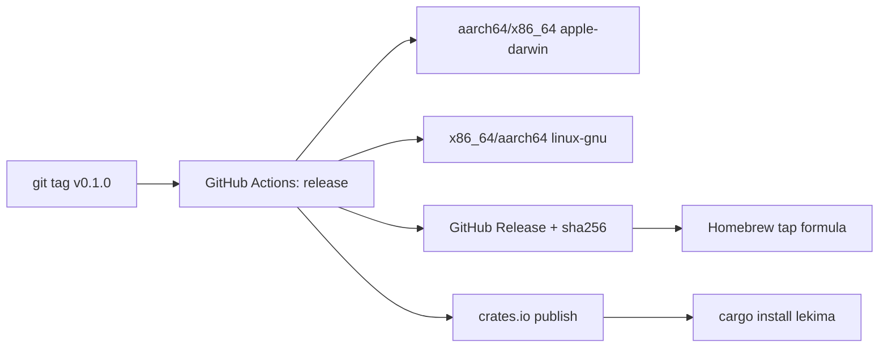

# Sprint 3 — System Design

> Companion to [`product-design.md`](./product-design.md).
> Theme: **Ship 0.1** — distribution, CI, reliability, queue editing, lyric
> translation.

Status: **Approved**

---

## 1. Quality attributes

| Attribute | Target |
| --- | --- |
| Install time (macOS, Homebrew) | < 60 s |
| CI wall time | < 3 min per OS |
| Test suite | no network, deterministic, < 30 s |
| Release repeatability | one command per channel, documented |
| Queue operations | O(n) in-memory, no playback gap on move/remove |
| Translation merge | timestamp-exact, no drift beyond 1 ms |

## 2. Distribution architecture



### 2.1 Repository identity

- Rename archived `benmooo/lekima` → `benmooo/lekima-go` (GitHub keeps redirects).
- Create/publicise `benmooo/lekima` for the Rust workspace.
- Default branch `main`; tags `v0.1.0`; release notes generated from CHANGELOG.
- Keep sprint-1/2 history (local commits) when pushing.

### 2.2 Versioning

- Workspace version `0.1.0`; every crate inherits it.
- CHANGELOG: Keep a Changelog format, one section per release.
- `ncmapi` dependency pinned to the published minor (`1.5`).
- Protocol/CLI/JSON/MCP are public API: breaking changes require a major bump.
- Binary version comes from `CARGO_PKG_VERSION`; `doctor` reports it.

### 2.3 Release pipeline

Options considered: `cargo-dist` vs hand-written matrix.

**Decision:** `cargo-dist` for build/archive/checksums/GitHub release, plus a
small Homebrew formula generated from the release asset URLs. Rationale:
battle-tested matrix, updater-friendly metadata, no bespoke shell.

Pipeline:

1. `cargo fmt --check`, clippy, tests (reuse CI).
2. `cargo publish --registry crates-io` (token scoped to `lekima`).
3. Tag `v0.1.0`; release workflow builds four targets, uploads `.tar.xz` +
   `.sha256`, creates the release.
4. Update the tap formula (`url`/`sha256`, version) from the release assets.
5. Verify `brew install`, `cargo install`, `lekima doctor` on a clean machine.

Secrets: `CARGO_REGISTRY_TOKEN` (scoped publish-new/update for `lekima`);
Homebrew tap uses a fine-grained PAT with contents:write on the tap repo.
Credentials never appear in logs; tokens live in GitHub secrets.

Unsigned macOS binaries: documented `xattr -d com.apple.quarantine` fallback.
Notarization is deferred (open question).

## 3. CI

`.github/workflows/ci.yml`:

| Job | Runner | Steps |
| --- | --- | --- |
| `test-macos` | `macos-14` | toolchain, fmt, clippy, test |
| `test-linux` | `ubuntu-24.04` | `libasound2-dev pkg-config`, fmt, clippy, test |
| `msrv` | `ubuntu-24.04` | toolchain 1.98, `cargo check --workspace` |
| `deny` | `ubuntu-24.04` | `cargo deny check` (licenses, advisories, bans) |
| `release` | tags `v*` | cargo-dist matrix + publish + release |

- Cache `~/.cargo/registry`, `~/.cargo/git`, `target` keyed by lockfile.
- `concurrency: group: ci-${{ github.ref }}, cancel-in-progress: true`.
- No network: tests use fakes; provider tests are fixture-only.
- `RUSTFLAGS=-D warnings` in CI so warning drift fails early.
- Linux audio: tests never open a device; `doctor` tolerates absence.

`deny.toml`: allow MIT/Apache-2.0/BSD/ISC; deny unknown registries; advisories
fail; duplicate versions warn.

## 4. Integration harness

### 4.1 Fake backends

The daemon currently constructs `NcmMusicService` and `RodioAudioEngine`
directly. For tests, introduce **backend selection in the binary** behind an
env var:

```text
LEKIMA_TEST_BACKEND=fake
```

- `fake` uses an in-memory `MusicService` (catalog fixtures) and a silent
  `AudioEngine` that records play/pause/seek/stop and advances position.
- Production path untouched; the branch is compiled in (small) and gated by the
  env var, or behind a `test-backend` Cargo feature used only by tests.

Preferred: a `--fake-backend` hidden flag plus env var, feature-gated
(`cfg(feature = "test-backend")`) so release binaries have no test code. The
test binary is built with the feature.

### 4.2 E2E test shape

```rust
// tests/e2e.rs
let dir = tempdir();
let socket = dir.join("lekima.sock");
let daemon = spawn_daemon(&dir, socket.clone(), FakeBackend::default());
wait_for_socket(&socket);
assert_json(run_cli(&dir, &socket, ["status"]), "stopped");
assert_json(run_cli(&dir, &socket, ["play", "mota"]), "playing");
...
daemon.shutdown();
```

Coverage:

- Every CLI subcommand: exit code, `ok`, stable fields.
- Queue editing: remove current/first/last, move current, move across current.
- Events: `watch --events status,queue` receives ordered seq; `since` replay;
  resync after a forced lag (small channel in tests).
- MCP: initialize, tools/list, tools/call success and error, stdin close.
- Settings persistence: write config, path resolution.
- Doctor JSON shape.

## 5. Queue editing

### 5.1 Domain and core

`Queue` gains:

```rust
pub fn remove_at(&mut self, index: usize) -> Option<Track>;
pub fn move_item(&mut self, from: usize, to: usize) -> bool;
```

Invariants:

- `current` always points at the same **track identity** when moving the current
  item; when moving another item across the current index, `current` shifts.
- Removing an item before the current index decrements it; removing the current
  item selects the item now at that position, or the previous one if it was the
  tail.
- `move` clamps to bounds and is a no-op when `from == to`.

`Player`:

```rust
pub async fn remove_at(&self, index: usize) -> Result<()>;
pub async fn move_item(&self, from: usize, to: usize) -> Result<()>;
```

- Removing the current track: stop audio, remove, then `load_current()` if the
  queue is non-empty (loading state applies); otherwise stop.
- Removing a non-current track does not touch audio.
- Moving the current track does not restart playback; moving another track does
  not affect audio.
- Events: publish `Queue` after either operation; `Status` if playback changed.

Edge cases: empty queue, out-of-range index (`bad_request`), remove while
`loading` (generation increment cancels the stale load).

### 5.2 Protocol, CLI, MCP

New commands:

```rust
QueueRemove { index: usize },
QueueMove { from: usize, to: usize },
QueueEnqueue { tracks: Vec<TrackId>, next: bool }, // existing Enqueue
```

Replies: `Queue { tracks, index }` (already exists).

CLI:

```
lekima queue remove <INDEX> [--json]
lekima queue move <FROM> <TO> [--json]
```

MCP tools `queue_remove`, `queue_move` with integer schemas; read-only false.

TUI: queue pane keys `x`, `J`, `K`; optimistic UI disabled (wait for reply),
selection adjusted to the moved/removed item; toast on error.

### 5.3 TUI selection rules

- Remove: selection stays at the same index (clamped to the new length).
- Move down/up: selection follows the moved item.
- Removing the current track while paused: playback stops (status in reply).

## 6. Lyric translation

### 6.1 Domain

```rust
pub struct LyricLine {
    pub at_ms: u64,
    pub text: String,
    pub translation: Option<String>,
}
```

Parser:

```rust
pub fn parse_lrc_with_translation(original: &str, translation: Option<&str>) -> Lyrics
```

- Parse each document independently, then merge by exact `at_ms`.
- Missing timestamps in the translation are ignored.
- `Lyrics` keeps `raw`; add `translation_raw: Option<String>` for `--json`.
- `Lyrics::plain_translated()` renders `text\n translation` pairs for the CLI.

### 6.2 Provider adapter

`ncmapi 1.5` already exposes `lrc` and `tlyric`; `lekima-ncm` passes both into
the parser. No new crate release required.

### 6.3 UI and CLI

- App state: `lyrics_translation: bool` from `[ui] lyrics_translation`
  (default false); part of `UiPreferences` and the settings palette
  (a fourth row: TRANSLATION on/off).
- `t` inside the lyrics pane toggles the session value; persisted on exit like
  theme/glyphs/density.
- Render: original line; if enabled and present, the translation on the next
  line in `dim`, indented under the text. Active line highlights both.
- Footer shows `T:ON` / `T:OFF` when any translation exists.
- CLI: `lekima lyrics --translate`, `--json` includes `translation` per line.
- MCP `lyrics` gains `translate` boolean; response includes translations when
  requested.

### 6.4 Persistence

`[ui] lyrics_translation = true|false`; `save_ui` extends to four keys.
Settings palette row order: THEME, GLYPHS, DENSITY, TRANSLATION.

## 7. Doctor, logs and session hygiene

- `doctor --json` adds: `binary` (path, version, target triple), `config`
  (`path`, `ok`, `error`), `socket` (`path`, `running`, `perms`), `session`
  (`present`, `perms`), `audio` (`ok`, `error`), `provider` (`ok`, `signed_in`),
  `log` (`path`, `size`), `cache` (`dir`, `size`).
- Log rotation: before opening, if `lekima.log` > 5 MiB rename to `.1`.
- Session permission check: if mode & 0o077 != 0, warn and `chmod 600`.
- `--version` includes git SHA when built by CI (`LEKIMA_GIT_SHA` env → build.rs
  or a generated const), optional.

## 8. Documentation structure

```
docs/
  install.md          # brew, cargo, tarball, platform notes
  first-run.md        # login, doctor, first play, settings
  agents.md           # watch + MCP + JSON contract
  releasing.md        # extended with binaries/tap
  sprint-3/           # this design
```

README first screen: one-liner, install, 3-command quickstart, screenshot,
links. SECURITY/CODE_OF_CONDUCT/CONTRIBUTING at root; `.github/ISSUE_TEMPLATE`.

## 9. Testing matrix

| Area | Tests |
| --- | --- |
| Queue domain | remove/move invariants, current identity, bounds, tail cases |
| Core | remove current while loading, move no restart, events |
| IPC | new command golden frames; MCP schemas |
| CLI | remove/move JSON + exit codes; lyrics --translate |
| TUI | queue key reducer, selection follow, translation render |
| LRC | merge exact timestamps, missing translations, untimed docs |
| Release | `cargo dist plan`, checksums, formula render (fixture) |
| CI | workflow lint (`actionlint`) locally |

## 10. Work breakdown

| # | Task | Depends | Done when |
| --- | --- | --- | --- |
| 1 | Docs (this sprint) | — | approved |
| 2 | Queue domain + core + tests | 1 | invariants green |
| 3 | IPC + CLI + TUI + MCP queue editing | 2 | e2e green |
| 4 | Translation parser + config + UI/CLI/MCP | 1 | render + CLI tests |
| 5 | Fake backend + e2e harness | 1 | suite < 30 s |
| 6 | Doctor/log rotation/perms | — | JSON fields tested |
| 7 | Repo rename + push | 1 | CI runs on GitHub |
| 8 | CI + deny + cargo-dist config | 7 | green matrix |
| 9 | LICENSE/CHANGELOG/SECURITY/CONTRIBUTING/templates | — | present |
| 10 | Install/first-run/agents docs | 3,4 | published |
| 11 | 0.1.0 tag + crates.io + tap | 8,10 | install verified |

## 11. ADRs

| ADR | Decision | Why |
| --- | --- | --- |
| 020 | Rename old repo, reuse `lekima` | Brand continuity; GitHub redirects; crate name free |
| 021 | cargo-dist for binaries | Less bespoke matrix code; checksums built in |
| 022 | Feature-gated fake backend | No test code in release binaries; deterministic e2e |
| 023 | Queue editing without undo | Small surface for 0.1; toast + visible state |
| 024 | Translation merged by exact timestamp | Provider timestamps are stable; no fuzzy drift |
| 025 | Persist translation preference | Matches theme/glyphs/density behaviour |
| 026 | No notarization in 0.1 | Cost/complexity; documented fallback |

## 12. Open technical questions

1. Does `cargo-dist` support publishing to crates.io in the same workflow, or do
   we keep publish as a separate manual/CI step? Proposal: separate `publish`
   job gated on the tag, after tests.
2. Homebrew formula: source build vs prebuilt binary? Proposal: prebuilt
   tarball per platform (no build toolchain on user machines).
3. Fake backend: `LEKIMA_TEST_BACKEND` env vs `--backend fake` flag. Proposal:
   both, feature-gated, hidden from help.
4. Event ring size: keep 256 for 0.1; revisit if agents need longer replay.
