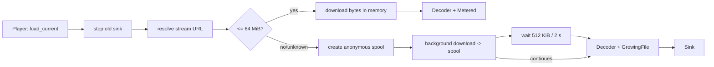

# Sprint 4 — System Design

> Companion to [`product-design.md`](./product-design.md).
> Theme: streaming playback, buffering, sleep timer, quality switching.

Status: **Approved for design**

---

## 1. Constraints

| Constraint | Consequence |
| --- | --- |
| rodio/symphonia pull samples on the audio thread | The reader must block or return data; never perform network I/O there |
| NetEase URLs support HTTP range but formats vary | Phase 1 streams sequentially; range seeks are phase 2 |
| `AudioEngine` is a domain port | Buffering state must be exposed without leaking rodio types |
| Previous-track stop is instant (sprint 3) | Keep `stop` before network; `loading` covers the gap |
| Single binary, no GStreamer | Spool + symphonia only |

## 2. Audio pipeline



### 2.1 Full-download path (unchanged)

- `reqwest` GET with UA/Referer, size guard, `Decoder::builder().with_data(Cursor).with_byte_len(len).with_seekable(true)`.
- Keeps memory playback and arbitrary seeks.

### 2.2 Spool path

New module `lekima-audio/src/spool.rs`:

```rust
pub struct Spool {
    state: Mutex<SpoolState>,   // written, total, complete, error, cancelled
    ready: Condvar,
}

pub struct GrowingFile {   // Read + Seek
    file: File,            // tempfile::tempfile(), cloned
    position: u64,
    spool: Arc<Spool>,
}
```

- Writer: `play_url` spawns a tokio task; `response.chunk().await` loop writes to
  the temp file, updates `written`, notifies the condvar. `Content-Length`
  captured into `total` when present.
- Reader `Read::read`:
  1. if `position < written`: `read_at` via `File::read` after seek; return data.
  2. if `complete`: return `Ok(0)` (EOF).
  3. if `error`: return `io::Error`.
  4. otherwise wait on the condvar (100 ms timeout to re-check cancellation).
- Reader `Seek`: absolute/relative within `[0, written]` allowed; beyond `written`
  returns `io::ErrorKind::Unsupported` (phase 1).
- Threshold: after creating the spool, `play_url` waits until
  `written >= min(total, 512 KiB)` or `2 s` of content estimated from bitrate,
  or completion, before sending `LoadSpool` to the audio thread. No network on
  the audio thread.
- Cancellation: `Spool::cancel()` sets a flag and notifies; the writer aborts on
  next chunk; `Stop`/new load cancels the previous spool and drops the file.
- Anonymous file: `tempfile::tempfile()` (no path, unlinked immediately).

### 2.3 Decoder construction

```rust
Decoder::builder()
    .with_data(GrowingFile::new(file, spool))
    .with_byte_len(total.unwrap_or(provisional_len))
    .with_seekable(true)
    .build()
```

- If `total` is unknown, `with_byte_len` is omitted (duration unknown).
- If decoder construction fails on a spooled format, fall back to full download
  once (bounded by `LEKIMA_FULL_DOWNLOAD_LIMIT`, default 512 MiB) and log a
  structured warning.

### 2.4 State

`PlaybackState` additions (serde defaults, additive):

| Field | Type | Meaning |
| --- | --- | --- |
| `buffering` | bool | decoder waiting on the spool |
| `buffered_ms` | u64 | estimated buffered position (0 when unknown/full) |
| `quality` | `Quality` | resolved class for the current stream |
| `sleep_remaining_ms` | Option<u64> | active sleep timer |

- `AudioEngine` port adds:
  ```rust
  fn buffered_ms(&self) -> u64 { 0 }
  fn is_buffering(&self) -> bool { false }
  ```
- Spool reader sets `buffering` while blocked; clears on data.
- Core maps them into the snapshot.

## 3. Seek policy

- `Player::seek(position)` calls `audio.seek`.
- Full download: succeeds anywhere.
- Spool:
  - target <= `buffered_ms` → normal seek;
  - target > `buffered_ms` → `DomainError::Playback("stream is still buffering")`
    (no silent clamp).
- TUI: if `buffered_ms > 0`, clamp the requested target to it and toast “buffered
  to …”; agents get the error code if they bypass the UI.
- Phase 2: HTTP `Range` restart for seeks beyond the buffer.

## 4. Sleep timer

Daemon-owned, tick-based:

```rust
struct SleepTimer { deadline: Option<Instant> }
```

- `Command::Sleep { minutes: Option<u32> }`; `None` cancels.
- Ticker checks the deadline every 500 ms; on expiry calls `player.pause()`.
- `Status`/`PlayerEvent::Status` include `sleep_remaining_ms`.
- Survives track changes; reset on daemon restart.
- CLI parses `30m`, `1h`, `90s`, `off`.
- MCP tool `sleep { minutes?: integer }`.

## 5. Quality

- `Player::quality` becomes interior mutable (`Mutex<Quality>`).
- `Command::SetQuality { quality }` updates the live value; applies on the next
  `load_current`.
- CLI writes `[playback] quality` via `lekima_config::save_quality` (same
  preserve-other-sections approach as `save_ui`) and sends `SetQuality`.
- Status exposes the quality used for the current stream.
- TUI settings palette gains a QUALITY row (standard/higher/exhigh/lossless).

## 6. Testing

| Area | Tests |
| --- | --- |
| Spool reader | chunked writes unblock reads; EOF after complete; error propagation; seek within written; seek beyond rejected; cancel wakes readers |
| Threshold | small download completes before threshold → immediate load; large waits |
| Decoder probe | fixtures for MP3/FLAC/WAV spooled; no end-seek deadlock (timeout guard) |
| Audio engine | full-download path unchanged (regression) |
| Core | seek beyond buffer error; buffering flags map to state |
| Daemon | sleep timer fires ±1 s, survives next/prev; cancel |
| CLI | `sleep`, `quality` JSON + exit codes; config persistence |
| TUI | HUD badges, `:sleep`, quality setting |
| Live | 1 GB WAV from cloud: first audio time, RSS, no temp leaks |

Live checks are `#[ignore]`/manual with a real account; CI uses fixtures.

## 7. Failure modes

| Scenario | Behaviour |
| --- | --- |
| Network stalls mid-track | reader blocks, `buffering=true`; resumes automatically; 30 s timeout → playback error + skip |
| Download 4xx/5xx | playback error before Load; state stopped |
| Decoder rejects spooled data | one full-download fallback; then error |
| Spool disk full | error before playback; temp dropped |
| Sleep fires during load | pause after load completes (deadline checked on state) |
| Quality changed mid-track | old stream continues; next track uses new class |
| Cancelled seek | no state change; TUI toast |

## 8. Work breakdown

| # | Task | Depends |
| --- | --- | --- |
| 1 | `spool.rs` + tests | — |
| 2 | Audio engine spool path + threshold + fallback | 1 |
| 3 | Port/state fields (`buffering`, `buffered_ms`, quality, sleep) | 2 |
| 4 | Seek policy in core + TUI clamp | 2,3 |
| 5 | Sleep timer (daemon/CLI/TUI/MCP) | 3 |
| 6 | Quality switch (config save + command + settings row) | 3 |
| 7 | Docs + live 1 GB test | 2 |
| 8 | 0.2.0 release | all |

## 9. ADRs

| ADR | Decision | Why |
| --- | --- | --- |
| 030 | Spool to anonymous temp file, not RAM | 1 GB tracks, flat RSS, no cleanup |
| 031 | Full download <= 64 MiB | Keeps fast-seek behaviour for normal tracks |
| 032 | Blocking growing reader | rodio pulls synchronously; no network on audio thread |
| 033 | Sequential streaming seek only (phase 1) | Range restart is a larger change; be explicit |
| 034 | Sleep timer pauses, not stops | Preserves queue and position |
| 035 | Quality applies next track | Never interrupt a stream mid-flight |

## 10. Open questions

1. Provisional byte length for unknown `Content-Length`: omit vs. estimate from
   bitrate. Proposal: omit; duration shows `--:--` until complete.
2. Fallback download cap for decoder-rejected streams: 512 MiB? Proposal: yes,
   configurable.
3. Spool quota: per-track only, or a cache budget? Proposal: per-track + disk
   free-space check (refuse under 1 GiB free).
4. Should sleep fade out? Proposal: no in phase 1; abrupt pause is predictable.
