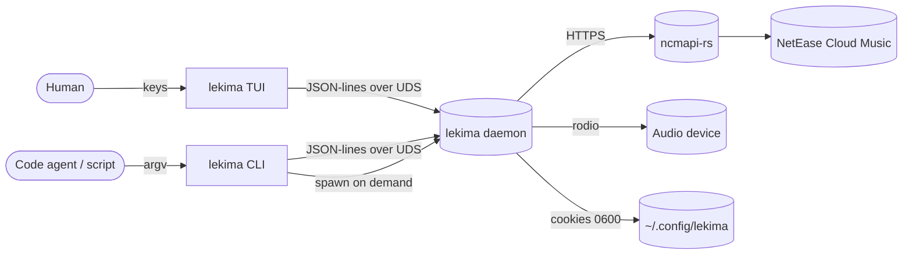
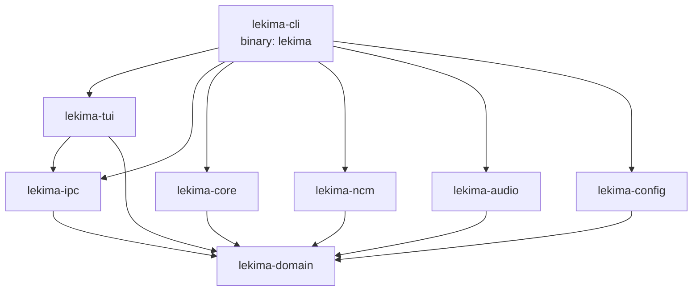
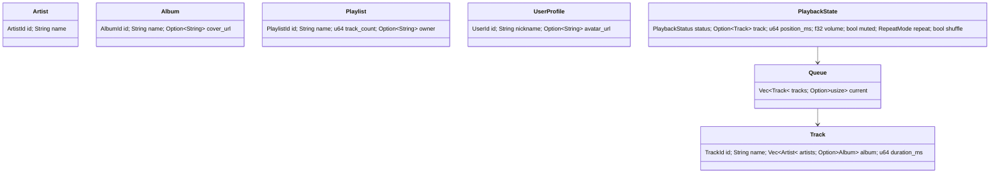
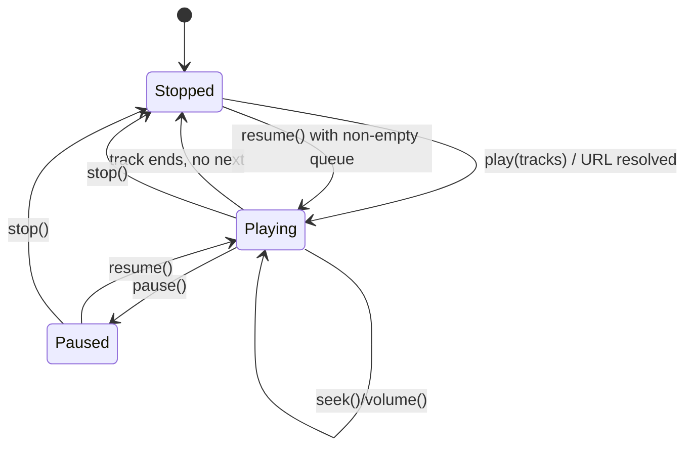
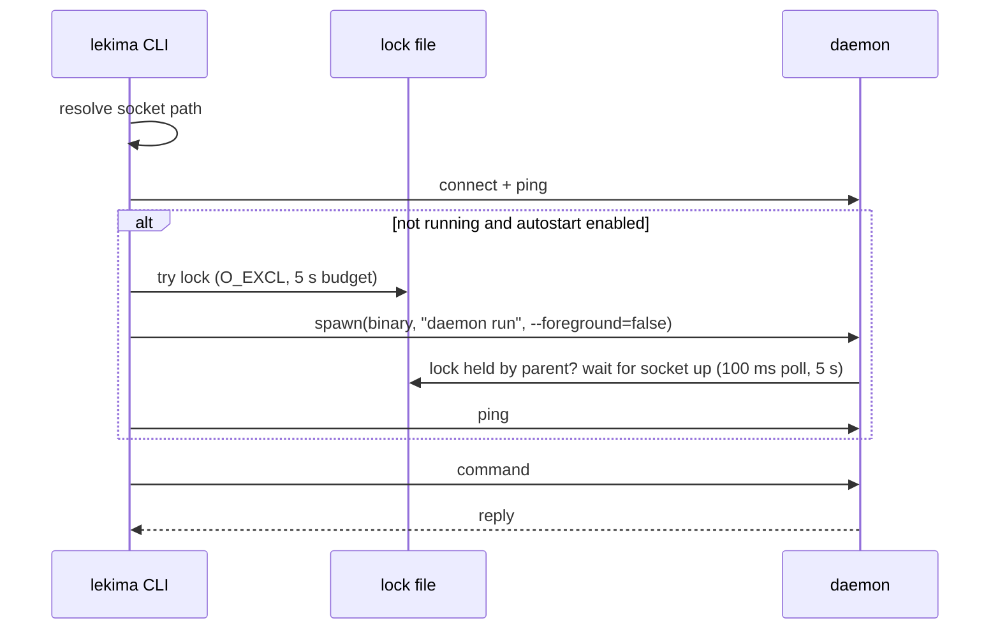
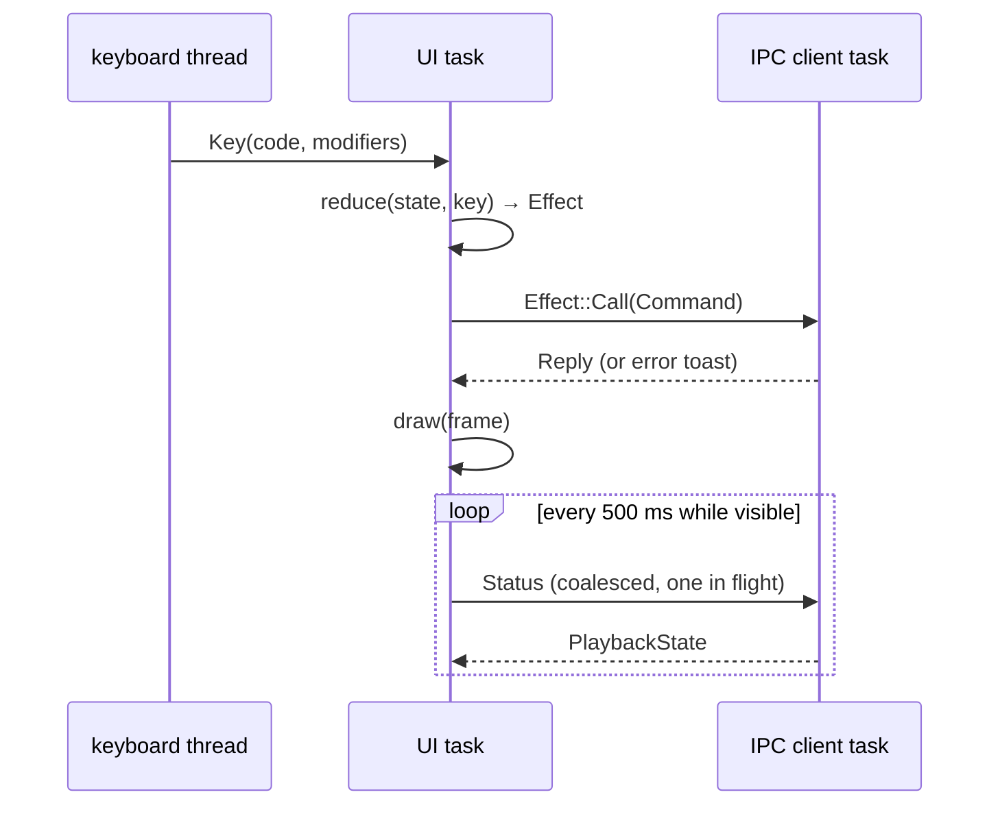

# lekima — System Design

Status: **Draft for v0.1** · Companion to [`product-design.md`](./product-design.md)

---

## 1. Goals and constraints

| Goal | Design consequence |
| --- | --- |
| Vim-fast UI | TUI never performs network I/O; it talks to a local daemon |
| Agent-drivable | Stable JSON CLI + Unix-socket protocol; playback survives process exit |
| Provider changes cheaply | All NetEase protocol knowledge behind one port + `ncmapi` |
| Testable rules | Queue/state machine is pure, in `lekima-domain`; no I/O in tests |
| Small blast radius | One writer of playback state; adapters are replaceable |
| Safe by construction | `unsafe` forbidden in first-party crates; secrets off argv/logs; strings sanitized |

Hard constraints: Rust 2024 edition, MSRV 1.98, macOS + Linux first-class,
single static binary, no mandatory system audio libraries beyond what rodio
needs (CoreAudio on macOS; ALSA/Pulse on Linux).

## 2. Context



Deployment is a single container in the logical sense but two processes at
runtime. The daemon is optional for read-only commands (`search`, `playlist
show`, `lyrics`, `capabilities`, `doctor` talk to the provider directly).

## 3. Containers and crates



Dependency rule: **arrows point inward**. `lekima-domain` depends on nothing
but `serde`, `thiserror`, `async-trait`. `lekima-core` may depend on domain
only. Adapters depend inward. The CLI is the composition root — the only crate
allowed to know every concrete type.

| Crate | Responsibility | Must not |
| --- | --- | --- |
| `lekima-domain` | Entities, queue rules, playback state, ports | Do I/O, know HTTP/audio/terminal |
| `lekima-core` | `Player`: queue + transport orchestration, auto-advance | Know about IPC or CLI |
| `lekima-config` | Paths, `config.toml`, cookie file (0600) | Parse provider payloads |
| `lekima-ipc` | Protocol types, UDS client/server framing | Contain business rules |
| `lekima-ncm` | `MusicService` over `ncmapi` | Expose raw provider JSON |
| `lekima-audio` | `AudioEngine` over rodio | Download catalogue metadata |
| `lekima-tui` | Rendering, keymap, client-side state machine | Block on the network or own playback |
| `lekima-cli` | Command parsing, daemon lifecycle, JSON rendering | Duplicate queue logic |

Workspace layout:

```
lekima/
├── Cargo.toml                # workspace, resolver 3, shared versions
├── docs/
│   ├── product-design.md
│   ├── system-design.md
│   └── adr/                  # architecture decision records
├── crates/
│   ├── lekima-domain/
│   ├── lekima-core/
│   ├── lekima-config/
│   ├── lekima-ipc/
│   ├── lekima-ncm/
│   ├── lekima-audio/
│   ├── lekima-tui/
│   └── lekima-cli/           # [[bin]] name = "lekima"
└── tests/                    # workspace-level integration tests
```

## 4. Domain model

Newtypes instead of raw integers (`TrackId`, `PlaylistId`, `UserId`,
`AlbumId`, `ArtistId`). Prevents id mix-ups at compile time and gives a single
place for validation. Serde is `transparent`, so the wire format stays `123`.



Queue invariants (unit-tested in `lekima-domain`):

- `current` is `None` iff `tracks` is empty; otherwise it is a valid index.
- `advance(Off)` returns `None` at the tail and leaves the cursor unchanged;
  `advance(All)` wraps; `advance(One)` repeats.
- `rewind` wraps only under `All`.
- `remove_current` clamps the cursor; removing the last track empties the queue.

## 5. Playback state machine



`Player` is the **only** writer. Guarantees:

- Transitions are serialized by a `tokio::sync::Mutex` around the inner state;
  the audio engine is called inside the critical section so observers never see
  “playing” before the sink is actually playing.
- A failed URL resolution never leaves the machine in `Playing`.
- `tick()` (called by the daemon every 500 ms) is the single place that reacts
  to end-of-track. No audio callback mutates application state.

## 6. Runtime architecture

### 6.1 Processes

| Process | Lifetime | Responsibility | Concurrency |
| --- | --- | --- | --- |
| Daemon (`lekima daemon run`, internal) | Long | Owns `Player`, provider session, socket listener | tokio multi-thread; one task per connection; one monitor task |
| CLI | Short | Parse args, call provider or daemon, print | `#[tokio::main]` |
| TUI | Session | Render, keymaps, call daemon | crossterm event thread + tokio client task |

The TUI is **not** the player. Closing it does not stop the music; that is the
whole point for agents and long coding sessions.

### 6.2 Daemon lifecycle



- Socket: `$XDG_RUNTIME_DIR/lekima.sock`, else `<config>/cache/lekima.sock`;
  overridable with `LEKIMA_SOCKET`.
- The socket directory is `0700`; the socket is `0600`.
- Stale-socket handling: connection refused + existing file ⇒ unlink and retry
  once, after taking the startup lock.
- Shutdown: `Shutdown` command or SIGTERM/SIGINT ⇒ stop audio, flush session,
  unlink socket. A `SIGKILL` leaves a stale socket that the next start reaps.
- Single instance per socket path enforced with an advisory lock on
  `lekima.lock`.
- Daemon logs to `<config>/lekima.log` via `tracing` (daily-free, size-capped,
  one rotated previous file) and to stderr when run with `--foreground`.

### 6.3 TUI event loop



- Rendering is pure: `view(&App) -> Frame`. The `App` reducer is unit-testable
  without a terminal using `ratatui::backend::TestBackend`.
- Network calls are fire-and-forget with request coalescing: a second `Status`
  request is skipped if one is in flight; key handling never awaits.
- Terminal restore is guarded by a drop type + panic hook (raw mode, alternate
  screen, cursor visibility).

### 6.4 Audio pipeline

```
stream URL ── reqwest GET (UA + Referer, cookie) ──► bytes
   │                                                  │
   │  (v0.1) full body, capped by Content-Length       │
   └──────────────► rodio Decoder (symphonia) ──► Sink ──► OutputStream
                                                  │
                              volume / pause / try_seek / empty() poll
```

Decisions:

- **v0.1**: download the body fully before decoding. NetEase URLs are
  HTTP-range-capable but full download is the smallest correct implementation;
  `Content-Length` is checked against `LEKIMA_MAX_TRACK_BYTES` (default 64 MiB).
- **v0.2**: progressive streaming via `reqwest::Response::bytes_stream()` into a
  bounded channel feeding `Decoder`. Enables instant start and seek on large
  lossless files.
- Seek: `Sink::try_seek` when the decoder supports it; the UI additionally
  updates `position_ms` optimistically and reconciles on the next status poll.
- Device errors (`NoDevice`, `DeviceBusy`) map to `ErrorCode::Playback` with a
  hint; `lekima doctor` enumerates devices.
- The output stream is kept alive for the daemon’s lifetime; one sink per track,
  replaced on load (rodio mixes old/new, so we `stop` + drop before loading).

## 7. IPC protocol

Line-delimited JSON over a Unix stream socket, one request per connection in
v0.1 (connection-per-call; simple, robust, cheap at local latencies).

```jsonc
// client → daemon
{"id":1,"command":{"type":"play","target":{"type":"query","query":"mota"}}}
// daemon → client
{"id":1,"result":{"type":"status","state":{"status":"playing","track":{...},"position_ms":0}}}
// daemon → client on failure
{"id":1,"error":{"code":"unauthorized","message":"run `lekima login`"}}
```

Properties:

- `MAX_FRAME_BYTES = 1 MiB`; oversized frames get one error and the connection
  closes (desynchronised streams are not recoverable).
- Unknown fields are ignored by serde for forward compatibility; unknown
  command types produce `bad_request`.
- `Response.id` echoes the request id.
- **v0.2**: `hello` handshake advertising `protocol_version`; the client rejects
  mismatched majors with a clear message. Push events (`status_changed`,
  `queue_changed`) reuse the same framing with an `event` key instead of `id`.

Security:

- Socket permissions `0600`, parent directory `0700`.
- On Linux, verify `SO_PEERCRED` uid matches the daemon owner; on macOS
  `getpeereid`. Reject otherwise. (Defence in depth; the socket mode already
  restricts access.)
- No authentication tokens on the wire; the session stays inside the daemon.

## 8. Provider adapter (`lekima-ncm`)

- `NcmMusicService` implements `MusicService` using `ncmapi::NcmClient`.
- Constructed once per daemon; cookie path = `<config>/session.cookies`
  (written by `lekima login`, `0600`).
- Mapping layer owns all provider quirks: nested artists, missing album, `fee`
  flags, duration in ms, and `code != 200` handling. Mapping functions are pure
  and property-tested against fixtures.
- Errors: HTTP/timeout ⇒ `Unavailable`; `code == 301` ⇒ `AuthenticationRequired`;
  empty result ⇒ `NotFound`; missing endpoint support ⇒ `Unsupported`.

### 8.1 Extending `ncmapi-rs`

`ncmapi` 1.0 exposes only search, track metadata, stream URLs, account and user
playlists. v0.1 works within that surface; v0.2 requires additions, released as
`ncmapi 1.1`:

| Endpoint | Route | Used by |
| --- | --- | --- |
| QR login start/poll | `/api/login/qrcode/unikey`, `/api/login/qrcode/client/login` | `lekima login --qr` |
| Playlist detail with tracks | `/api/v6/playlist/detail` + `/api/v3/song/detail` | `playlist show`, sidebar — **done in 1.1** |
| Lyrics | `/api/song/lyric` | `lekima lyrics` — **done in 1.1** |
| QR login | `/api/login/qrcode/*` | `lekima login --qr` — **done in 1.1** |
| Daily recommendations | `/api/v3/discover/recommend` | Daily section — next |
| Personal FM | `/api/v1/radio/get` | FM section — next |
| Like / unlike | `/api/radio/like` | track actions (`f`) — next |
| Toplists | `/api/toplist` | sidebar — next |

Note: `/api/playlist/track/all` is no longer served (404). Playlist detail
returns the full ordered `trackIds` list; pages are sliced locally and hydrated
through `/api/v3/song/detail` in batches of 500.

Process: developed on a branch with a path patch (`[patch.crates-io]` in this
workspace), contract tests per route, deterministic suite green, version bumped
to 1.1.0. Remaining before publish: run `cargo publish --dry-run`, publish, then
replace the path patch with `ncmapi = "1.1"`. Public API stays additive; the existing
`NcmClient`/service shape is preserved.

## 9. Configuration

`<config>/config.toml`, parsed strictly (`deny_unknown_fields`) so typos fail
loudly:

```toml
[provider]
cache = true
cache_ttl_secs = 180

[playback]
volume = 0.7
quality = "exhigh"   # standard | higher | exhigh | lossless
autoplay = true

[ui]
alternate_screen = true
show_help_on_start = false

[daemon]
autostart = true
log_level = "info"
```

Precedence: defaults → file → environment (`LEKIMA_CONFIG_DIR`,
`LEKIMA_SOCKET`, `LEKIMA_LOG`, `LEKIMA_THEME`, `NO_COLOR`). Flags win over all.

Files: `config.toml`, `session.cookies` (0600), `lekima.log`, `cache/`
(response cache, future offline metadata). Nothing outside the root is written.

## 10. Error taxonomy and mapping

| Domain error | IPC code | Exit | UX |
| --- | --- | --- | --- |
| `InvalidInput` | `bad_request` | 2 | Inline usage hint |
| `AuthenticationRequired` | `unauthorized` | 3 | “run `lekima login`” |
| `NotFound` | `not_found` | 4 | “no matches for …” |
| `Unsupported` | `unsupported` | 8 | “not available for this track” |
| `Unavailable` | `backend` | 5 | Retry hint, provider status |
| `Playback` | `playback` | 6 | Device hint + `doctor` |
| IPC unreachable | `daemon` | 7 | Autostart hint |
| Any other | `internal` | 1 | “this is a bug”, log path |

Rules: adapters never construct user-facing prose with format-string injection
from provider data; messages are structured and rendered by the frontend.

## 11. Observability

- `tracing` spans: `ipc.request`, `player.play`, `ncm.request` (URL path only,
  never query payloads with cookies), `audio.load`.
- Log levels via `RUST_LOG`; default `info`, `debug` adds state transitions,
  `trace` adds protocol frames with secrets redacted.
- `lekima doctor --json` reports: version/build, socket path & reachability,
  daemon pid/uptime, session present (boolean, never the value), audio device,
  provider reachability, config file errors.
- In-memory ring buffer (last 128 IPC calls) exposed by `daemon logs --json` for
  post-mortem without filesystem access.

## 12. Security & privacy

1. Session cookie is a bearer credential: file `0600`, directory `0700`, never
   in argv, never logged, redacted in error payloads, cleared by `logout`.
2. `lekima login` accepts stdin/file only (`--cookie-file -`), warns when a TTY
   is absent and stdin is empty.
3. Terminal injection: sanitize all provider strings (strip C0/C1, ESC, OSC/CSI,
   bidi overrides) before rendering or printing. Unit-tested with hostile
   fixtures.
4. No telemetry, no analytics, no phone-home. Provider requests go only to
   NetEase hosts.
5. `#![forbid(unsafe_code)]` in every first-party crate.
6. `cargo audit` / `cargo deny` in CI; dependency review before release.
7. Provider downloads are capped and never written to a user-visible library;
   caching is metadata-only.

## 13. Performance budgets

| Metric | Budget | Measurement |
| --- | --- | --- |
| CLI cold start (`status`) | < 100 ms | hyperfine in CI benchmark |
| Key → screen update | < 16 ms | `TestBackend` frame timing |
| Daemon idle RSS | < 40 MB | CI on Linux |
| Daemon RSS while playing | < 80 MB (128 kbps), < 200 MB (lossless, v0.1 full download) | manual |
| Provider search | < 800 ms p50 | tracing histogram |
| Socket round-trip | < 2 ms p99 local | tracing |
| Status poll rate | 2 Hz idle, 4 Hz visible, 0 when TUI hidden | code review |

## 14. Testing strategy

| Layer | Technique |
| --- | --- |
| Domain | Pure unit tests for queue/state edge cases; property tests for invariants |
| Core | Fake `MusicService` + fake `AudioEngine`; transition and failure-injection tests |
| NCM adapter | Fixture payloads → domain mapping; `wiremock` for transport errors; no live network in CI |
| IPC | Encode/decode golden tests; server loop tests with `tokio::io::duplex` |
| CLI | `assert_cmd` + `insta` snapshots for human and `--json` output; exit codes |
| TUI | `TestBackend` snapshot + reducer tests (key sequences) |
| E2E | Spawn daemon with fake provider + fake audio, drive CLI, assert JSON |
| Faults | Corrupt cookie, socket removed mid-call, provider 5xx, oversized frame, SIGTERM |
| CI | `fmt --check`, `clippy -D warnings`, tests on macOS + Linux, `cargo deny` |

Live-provider smoke tests are `#[ignore]` and run manually with a dedicated
account.

## 15. Packaging & release

- `cargo-dist` builds `aarch64-apple-darwin`, `x86_64-apple-darwin`,
  `x86_64-unknown-linux-gnu`, `aarch64-unknown-linux-gnu`.
- Homebrew tap, `cargo install lekima`, GitHub Releases with checksums.
- SemVer: protocol and CLI are public APIs. Breaking CLI/JSON change ⇒ major.
- MSRV policy: latest stable; documented in `Cargo.toml`.
- `ncmapi` releases are decoupled but listed in the changelog when a feature
  depends on a new version.

## 16. Architecture decision records

| ADR | Decision | Why |
| --- | --- | --- |
| 001 | Daemon + thin clients | Playback outlives UIs; agents need stateless invocations |
| 002 | Unix socket, JSON lines | Debuggable with `nc -U`, no schema compiler, forward compatible |
| 003 | ratatui + crossterm | Actively maintained, testable `TestBackend`, standard choice |
| 004 | rodio + symphonia | Pure-Rust decoding for mp3/aac/flac; no GStreamer dependency |
| 005 | Newtype ids | Compile-time safety across five id kinds |
| 006 | `ncmapi-rs` extended, not forked | Single client library, shared maintenance, published releases |
| 007 | Cookie-file login first, QR second | Unblocks v0.1 without new endpoints; QR is the polished path |
| 008 | Strict config parsing | Typos surface immediately instead of silently defaulting |
| 009 | Full-download playback in v0.1 | Fewest moving parts; streaming behind the same port in v0.2 |
| 010 | Poll status in v0.1, push events in v0.2 | Correctness first; protocol already supports unsolicited frames |

## 17. Failure modes

| Scenario | Behaviour |
| --- | --- |
| Daemon dies mid-TUI | TUI shows “daemon lost”, retries connect every 2 s, offers `R` to restart |
| Song URL 404/VIP | Toast, skip after 2 s (`--strict` stops instead) |
| Audio device disappears | Playback error, state → Stopped, hint to run `doctor` |
| Cookie expired | `unauthorized`, browsing still works, login hint |
| Provider 5xx/timeout | `backend`, no state corruption; last track keeps playing |
| Queue empty + `next` | `Ack`, state Stopped, exit 0 (not an error) |
| Two daemons raced | Advisory lock; loser exits 0 with pid of winner |
| TUI killed with SIGKILL | Terminal may be left in raw mode; `lekima doctor --fix` and `reset` documented |
| Malformed provider JSON | Mapping returns `Unavailable`, never panics |

## 18. What exists today (honest status)

All eight crates build and are covered by 35 unit tests, 24 `ncmapi` contract
tests, TUI render tests and CLI contract tests (`cargo test --workspace`).

Working end to end against the live provider:

- search, stream URL resolution, playlist listing, full playlist paging, lyrics
- playback (rodio/CoreAudio verified), pause/resume/stop/next/prev/seek/volume,
  repeat cycle, queue add/jump/clear, auto-advance on track end
- daemon lifecycle (autostart, socket permissions, SIGTERM, log file, autostart
  race handling), CLI JSON contract and exit codes, `doctor`, `capabilities`,
  completions, `login --qr`, `login --cookie-file -`, `logout`
- TUI: header/progress, track table, sidebar playlists, queue overlay, search
  prompt, `:` command line, help overlay, vim keys

`ncmapi` 1.1 adds playlist detail/paging, lyrics and QR login with contract
tests; it is wired through `[patch.crates-io]` locally and still needs to be
published before lekima 0.1.

Known gaps: daily recommendations, personal FM, like/unlike, toplists, a lyrics
pane in the TUI, and push events (the TUI polls status every 250 ms).
